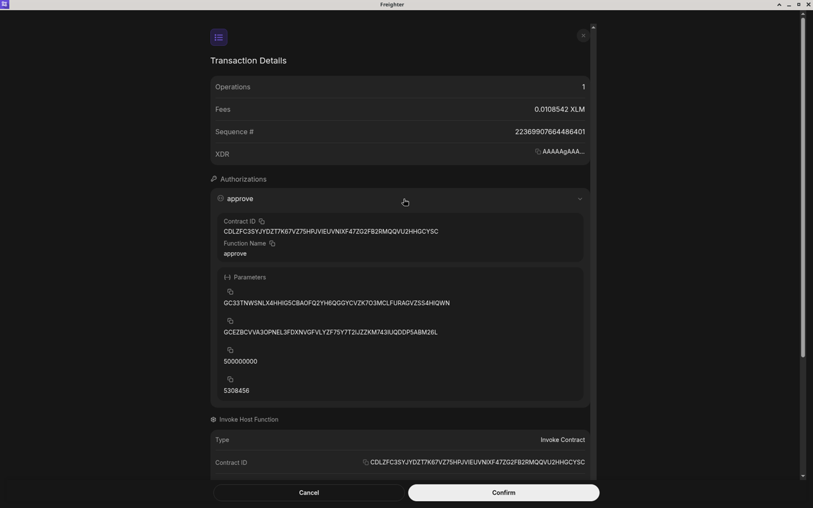
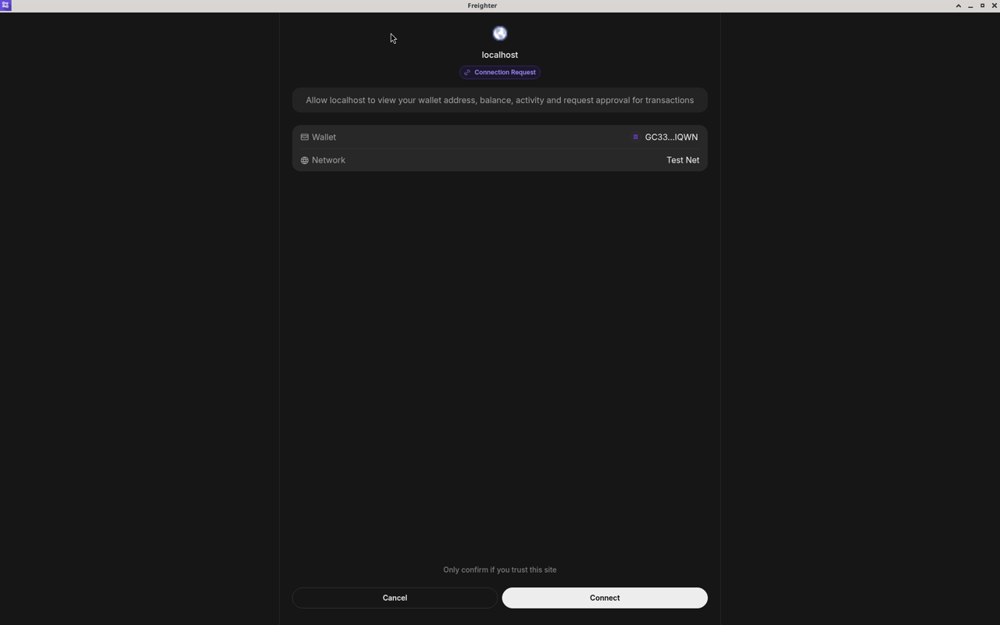
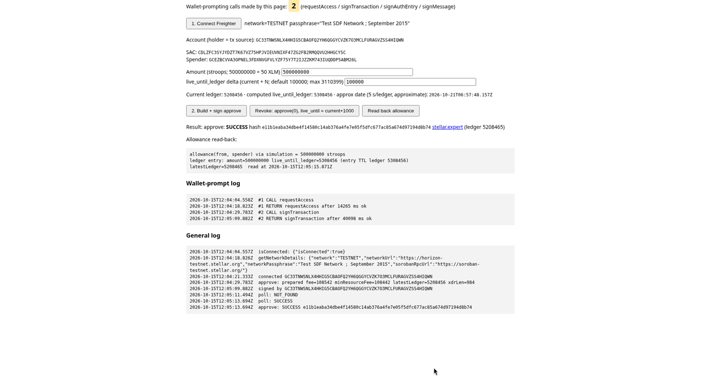
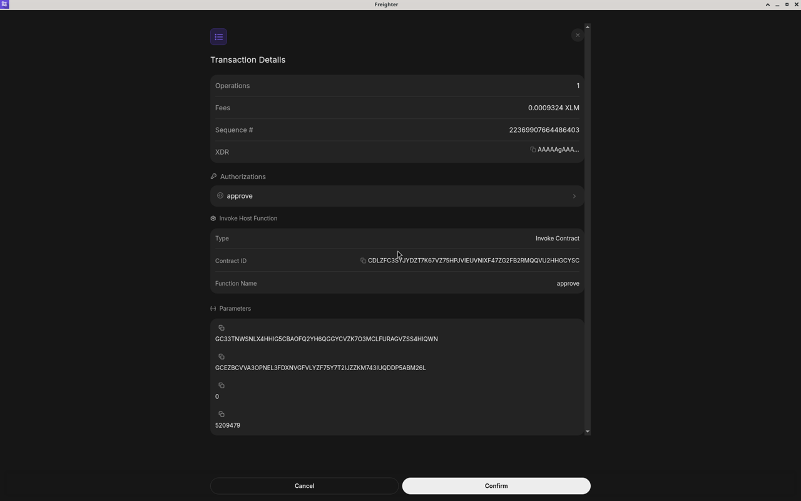
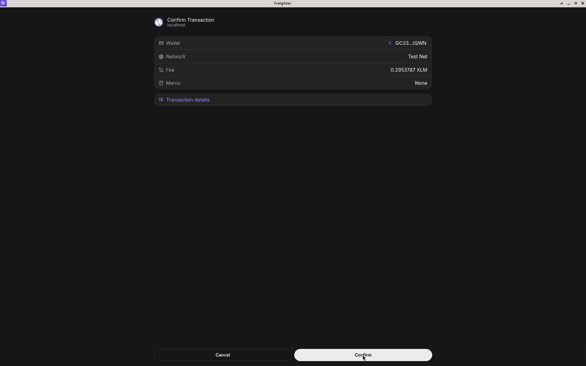
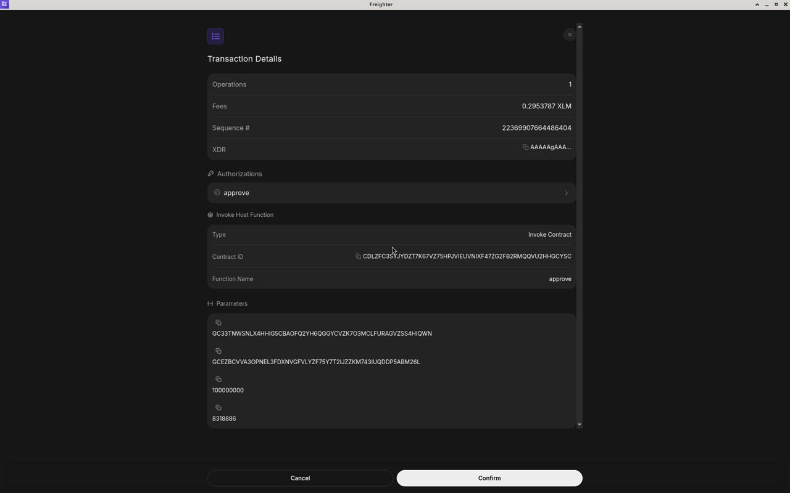
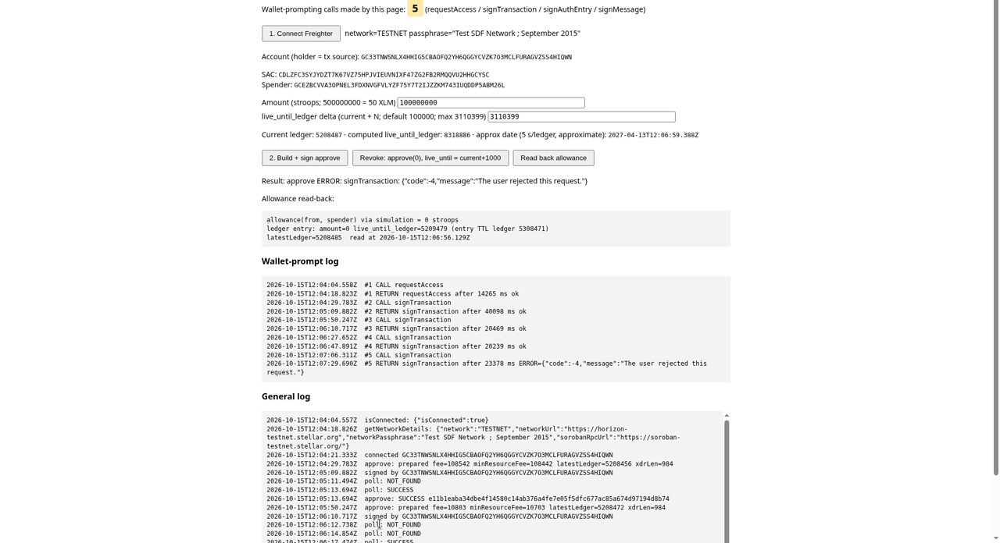

# Freighter prompt for a SAC `approve` — what the user actually sees

**Testnet, 2026-10-15. Measurement only — no product code was written and
`packages/` and `apps/` are untouched.** This answers the question the sibling
spike left open in
[`2026-10-14-sac-allowance-spike` §5](../2026-10-14-sac-allowance-spike/README.md):
how many prompts a Soroban `approve` produces in Freighter, and what the prompt
shows about `amount` and `live_until_ledger`. Where something could not be
established it says `undetermined`.

| | |
|---|---|
| Wallet | Freighter **5.49.0** (extension id `bcacfldlkkdogcmkkibnjlakofdplcbk`) in Chrome 154.0.8037.97 on Linux |
| Network | Testnet (`Test SDF Network ; September 2015`) |
| Account (holder and transaction source) | `GC33TNWSNLX4HHIG5CBAOFQ2YH6QGGYCVZK7O3MCLFURAGVZSS4HIQWN` |
| Native XLM SAC | `CDLZFC3SYJYDZT7K67VZ75HPJVIEUVNIXF47ZG2FB2RMQQVU2HHGCYSC` |
| Spender | `GCEZBCVVA3OPNEL3FDXNVGFVLYZF75Y7T2IJZZKM743IUQDDP5ABM26L` |

The account is a throwaway, friendbot-funded for this test. The spender is the
same throwaway identity the sibling spike used as its "engine". No key or
recovery phrase appears anywhere in this directory.

---

## Verdict

**One signing prompt per `approve`. The prompt is not legible for an
allowance.** The first screen shows the fee and nothing about the approval; the
amount, the spender and the expiry are one click deeper, as unlabelled raw
numbers.

1. **First connection:** one connection-permission popup, no signing
   (`requestAccess`).
2. **Each `approve`:** exactly **one** signing popup (`signTransaction`).
   There was no unlock screen, no second popup after **Confirm**, and no
   `signAuthEntry` or `signMessage` call at any point.
3. **The first screen cannot tell an allowance from any other contract call.**
4. **Amount and expiry are raw:** the amount is in stroops (never XLM) and the
   expiry is a ledger number with no date.
5. **A revoke is an `approve`.** The prompt shows the function name `approve`
   and a bare `0`.
6. **Overwriting is silent.** Approving a second amount while one is live
   replaced the first; nothing in the prompt says so.

---

## 1 · How it was tested

A small throwaway web page, served locally and **not committed** (see
[The test page](#the-test-page)), called Freighter through its API, with the
Freighter popup handled by hand in a real browser. Every `requestAccess`,
`signTransaction`, `signAuthEntry` and `signMessage` call the page made was
logged with timestamps, so the prompt count below is the page's own count, not
an observer's.

Wallet-prompt log, verbatim (`raw/wallet-prompt-log.txt`; all times
2026-10-15 UTC):

```
2026-10-15T12:04:04.558Z  #1 CALL requestAccess
2026-10-15T12:04:18.823Z  #1 RETURN requestAccess after 14265 ms ok
2026-10-15T12:04:29.783Z  #2 CALL signTransaction
2026-10-15T12:05:09.882Z  #2 RETURN signTransaction after 40098 ms ok
2026-10-15T12:05:50.247Z  #3 CALL signTransaction
2026-10-15T12:06:10.717Z  #3 RETURN signTransaction after 20469 ms ok
2026-10-15T12:06:27.652Z  #4 CALL signTransaction
2026-10-15T12:06:47.891Z  #4 RETURN signTransaction after 20239 ms ok
2026-10-15T12:07:06.311Z  #5 CALL signTransaction
2026-10-15T12:07:29.690Z  #5 RETURN signTransaction after 23378 ms ERROR={"code":-4,"message":"The user rejected this request."}
```

Five wallet-prompting calls in total: one `requestAccess`, four
`signTransaction`. Each call was answered by exactly one Freighter window. The
"after N ms" figures include the time spent reading the screen and clicking, so
they say nothing about wallet speed.

---

## 2 · What the prompt shows

### First screen — "Confirm Transaction" (`localhost`)

Shows: wallet (truncated address), network **Test Net**, **Fee**, **Memo**
(`None`), a **Transaction details** link, and **Cancel** / **Confirm**.

**Does not show:** the amount, the spender, the expiry, the function name or
the contract. For an `approve` the only number on this screen is the fee.


*The whole decision screen for `approve(500000000)`. Fee 0.0108542 XLM.*

### "Transaction details"

Shows: **Operations** (1), **Fees**, **Sequence #**, a truncated **XDR**, then
two sections:

- **Authorizations** — one collapsible entry named `approve`. Expanded, it shows
  **Contract ID**, **Function Name** `approve` and **Parameters**.
- **Invoke Host Function** — **Type** `Invoke Contract`, **Contract ID**,
  **Function Name** `approve`, then **Parameters**.

The parameters are four values with **no labels**, in this order:

| position | meaning | shown as | example (run 1) |
|---|---|---|---|
| 1 | `from` | account address | `GC33…IQWN` (full address in the screen) |
| 2 | `spender` | account address | `GCEZ…M26L` (full address in the screen) |
| 3 | `amount` | **raw stroops**, never XLM | `500000000` |
| 4 | `live_until_ledger` | **raw ledger number**, no date | `5308456` |

There was no warning, no "unable to decode" message, and no wording about
replacing or overwriting an existing allowance.


*Parameters in the order from, spender, amount, live_until_ledger.*


*The expanded `approve` authorization repeats the same four unlabelled values.*

### The connection popup


*First connect only. It asks the site for the wallet address, balance and
activity and for permission to request approval; nothing is signed.*

---

## 3 · The four runs

| # | what the page asked for | prompt showed (amount, expiry ledger) | outcome |
|---|---|---|---|
| 1 | `approve` 500000000 (50 XLM) | 500000000, 5308456 | confirmed — [`e11b1eab…8b74`](https://stellar.expert/explorer/testnet/tx/e11b1eaba34dbe4f14580c14ab376a4fe7e05f5dfc677ac85a674d97194d8b74), ledger 5208465 |
| 2 | `approve` 300000000 while 500000000 was live | 300000000, 5308471 | confirmed — [`94eea408…1593`](https://stellar.expert/explorer/testnet/tx/94eea4085c93add010d13ac2657bc1d1d070a081084203c9a9ebef5e8fae1593), ledger 5208478 |
| 3 | revoke: `approve` 0 | `0`, 5209479 | confirmed — [`4140dc44…b505`](https://stellar.expert/explorer/testnet/tx/4140dc441de6ab2977cfbaa0802a8299ace145d0c72873564f52fa3b5f87b505), ledger 5208485 |
| 4 | `approve` 100000000 with `live_until_ledger` at `current + 3,110,399` | 100000000, 8318886 | **rejected in the wallet**, nothing submitted |

Full hashes are in the table link targets and in `raw/`. The explorer view of
each submitted transaction is in `screenshots/11` to `13`; testnet is reset
periodically, so the Horizon records in `raw/` are the durable copy.

**Run 1 — allowance created.** Readback after the transaction: allowance
`500000000`, `live_until_ledger` 5308456.


*The page's own readback after run 1. The browser tab strip and the page's
heading are cropped out of this screenshot and of screenshot 10.*

**Run 2 — replaced, not added.** With 500000000 live, approving 300000000
left the readback at `300000000`, not 800000000. The prompt did not mention the
existing allowance.


**Run 3 — revoke is `approve(0)`.** The prompt shows the function `approve` and
a bare `0` as the amount. Its fourth value, 5209479, is the page's
`current + 1000` choice for a revoke, not a feature of the wallet. Nothing on
screen says "revoke" or "cancel".



**Run 4 — far expiry, rejected.** This run used the largest legal horizon the
sibling spike measured (`current + 3,110,399`). The prompt was shown as for the
other runs and was rejected in the wallet. The page received
`{"code":-4,"message":"The user rejected this request."}` and nothing was
submitted. The fee on this prompt was **0.2953787 XLM**, against 0.0108542,
0.0010803 and 0.0009324 for runs 1 to 3.







**The expiry in the prompt matches the ledger entry.** For runs 1 and 2 the
`live_until_ledger` shown in the prompt (5308456, 5308471) is the value the
ledger entry read back afterwards.

---

## 4 · The fee on the first screen is a ceiling, not the cost

The first screen's **Fee** is the transaction's prepared maximum fee. Horizon's
`fee_charged` for the three submitted transactions (read from
`https://horizon-testnet.stellar.org/transactions/<hash>` on 2026-10-15) is
lower:

| run | prompt fee (XLM) | Horizon `max_fee` (stroops) | Horizon `fee_charged` (stroops) |
|---|---|---|---|
| 1 | 0.0108542 | 108542 | 90709 |
| 2 | 0.0010803 | 10803 | 5728 |
| 3 | 0.0009324 | 9324 | 4441 |
| 4 (rejected) | 0.2953787 | — | — (never submitted) |

The prompt fee equals `max_fee` in each submitted case. A user who compares
the prompt with their balance afterwards will see a smaller charge.

> **`undetermined`:** why run 4's prompt fee is about 27 times run 1's. Run 4
> differed in two inputs, the amount and the far expiry, and the cause was not
> isolated. "A far `live_until_ledger` costs more" is a hypothesis, not a
> finding.

---

## 5 · Finding for the allowance screen

It is one prompt, but the first screen is not legible for an `approve`. A user
who trusts the wallet alone sees a fee and a **Confirm** button. A user who
opens **Transaction details** sees `500000000` and `5308456` with no labels.

The dashboard allowance screen therefore has to carry the meaning itself,
immediately before the user presses **Confirm** in the wallet:

- the **amount in XLM and in stroops**;
- the **spender**;
- the **expiry as a date and as a ledger number**;
- that the new approval **replaces** the current allowance, and what that
  current allowance is;
- that **revoking is `approve` with amount `0`**, so the wallet will say
  `approve` for it as well;
- the **parameter order Freighter shows** — from, spender, amount,
  live_until_ledger — so the user can match the unlabelled numbers.

This is a statement about Freighter 5.49.0 only. Nothing here says another
wallet behaves the same way.

---

## 6 · What is `undetermined`

- **Other wallets:** Lobstr, xBull, Albedo, hardware wallets. Not tested.
- **Mobile.** Not tested.
- **Other Freighter versions and UI languages.** Only 5.49.0 in its default
  language was observed.
- **The sponsored shape** — Evergreen submits and pays the fee while the user
  only authorizes, using address credentials and `signAuthEntry`. Not tested.
  `@stellar/stellar-sdk` 17.2.1, used by the test page, adds
  `SorobanCredentialsAddressV2`; whether Freighter handles it was not checked.
- **The cause of run 4's high prompt fee** (see §4).
- **Behaviour with more than one contract in a single transaction.** Not
  tested; every run used one operation on one contract.

---

## The test page

The page is a throwaway and is **not committed**; the source is available on
request. What it does:

- connects to Freighter and records every wallet-prompting call with a
  timestamp and a running count;
- builds and simulates an `approve` on the native XLM SAC from the connected
  account, with the amount and a `live_until_ledger` offset as inputs;
- sends the transaction to Freighter with `signTransaction`, submits the signed
  result to testnet and polls until it succeeds or fails;
- reads the allowance back two ways, by simulation and from the ledger entry;
- has a revoke button that builds `approve` with amount `0`.

Versions: `@stellar/freighter-api` 6.0.1, `@stellar/stellar-sdk` 17.2.1,
`vite` 8.3.4.

**Two earlier transactions are not evidence for the wallet prompt.** While the
page's build and readback code was being checked, an approve
([`aeefc103…ab3b6`](https://stellar.expert/explorer/testnet/tx/aeefc10348995bba7bb5e3ee92b47964bb5e6963487bf3ffd4d0bb582d4ab3b6),
ledger 5208399) and a revoke
([`fcc2ad77…baf6`](https://stellar.expert/explorer/testnet/tx/fcc2ad777a545d728cc8e19d9dbaf843788cc8e17ff8d8c1fb1e1ba53738baf6),
ledger 5208401) were submitted from a different throwaway account, signed with
an in-memory throwaway key. Freighter was not involved in either, so they say
nothing about what the wallet shows.

---

## Files

| file | what |
|---|---|
| `raw/wallet-prompt-log.txt` | the page's wallet-prompt log, verbatim |
| `raw/tx-approve-500000000.json` | run 1, full Horizon record |
| `raw/tx-approve-300000000-replaces.json` | run 2, full Horizon record |
| `raw/tx-revoke-approve-zero.json` | run 3, full Horizon record |
| `screenshots/01` … `screenshots/10` | the Freighter windows and the page state for each run, in run order. Screenshots 5 and 10 are cropped below the page heading; the rest are full-frame, converted to PNG without other edits |
| `screenshots/11` … `screenshots/13` | stellar.expert testnet view of the three submitted transactions (runs 1 to 3), captured 2026-10-16. The browser tab strip is cropped off; the address bar and the page are as captured |

Run 4 has no transaction record because nothing was submitted.
